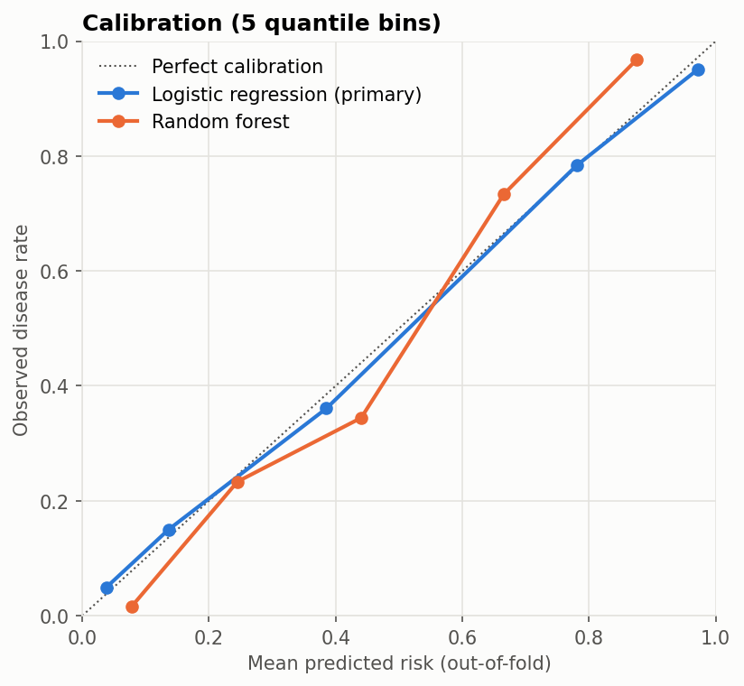

# Coronary Artery Disease Risk Model (UCI Cleveland)

An interpretable, **calibrated** logistic regression model for angiographic coronary artery disease in 303 patients referred for angiography. It's evaluated with repeated cross-validation, confidence intervals, a sensitivity-targeted operating point and calibration analysis, and compared with a random forest.

Reproduced by [`notebooks/heart_disease_risk_model.ipynb`](notebooks/heart_disease_risk_model.ipynb).

> Research and education only. This isn't a clinical decision tool.

## Results

**Discrimination and overall accuracy** (stratified 5-fold CV ×20; all preprocessing inside folds):

| Model | ROC-AUC (95% CI) | PR-AUC | Brier score |
|---|---|---|---|
| **Logistic regression (primary)** | **0.907** (0.874–0.940) | 0.899 | 0.118 |
| Random forest | 0.898 (0.865–0.931) | 0.891 | 0.132 |

The Brier score for predicting the 45.9% prevalence for everyone is 0.248. The simpler model is at least as good.

**Operating points** (held-out patients, mean over 20 repeats):

| Logistic regression | Sensitivity | Specificity | PPV | NPV |
|---|---|---|---|---|
| Threshold 0.5 | 0.792 | 0.886 | 0.855 | 0.834 |
| Threshold set in training folds for 90% sensitivity | **0.896** | 0.704 | 0.720 | **0.889** |

The sensitivity-targeted threshold is chosen from inner cross-validation on each training fold only. On unseen patients it reached a mean sensitivity of 0.896 against the 90% target, slightly below it, as expected when a threshold tuned on training data is applied to new patients.

**Calibration:** logistic regression's predicted risks closely track observed disease rates. The random forest is less calibrated at the extremes.



**Adjusted odds ratios** (complete cases, n = 297): vessels coloured on fluoroscopy OR 3.43 per SD (95% CI 2.05–5.73); reversible thallium defect 4.03 (1.75–9.26) vs normal; flat ST slope 3.18 (1.25–8.04) vs upsloping; male sex 4.69 (1.66–13.26); resting BP 1.54 per SD (1.04–2.28). In this referral cohort, typical angina (0.12) and non-anginal pain (0.16) carry lower odds than asymptomatic presentation.

## Methods

- **Data:** official UCI `processed.cleveland.data`; outcome = any major vessel > 50% narrowed (`num > 0`).
- **Preprocessing (scikit-learn `Pipeline`, fit per fold):** median imputation and scaling for continuous variables; mode imputation for sex, fasting blood sugar and exercise angina; mode imputation and one-hot encoding for chest-pain type, resting ECG, ST slope and thallium result.
- **Validation:** repeated stratified CV with out-of-fold probabilities; percentile bootstrap CIs; calibration curve; Brier score.

## Limitations

- **Referral population with 46% prevalence**, so predictive values and the chest-pain pattern don't transfer to screening settings.
- **Single centre, 1980s data, n = 303, with no external validation.** The Hungarian, Swiss and VA cohorts in the same archive are the obvious next test.
- `ca` (fluoroscopy) and `thal` (thallium scan) come from specialist testing, so this isn't a primary-care risk score.
- Disease severity (`num` 1–4) is collapsed to a binary outcome.

## Reproduce

```bash
python -m venv .venv
.venv\Scripts\activate            # macOS/Linux: source .venv/bin/activate
pip install -r requirements.txt
pytest
jupyter nbconvert --to notebook --execute --inplace notebooks/heart_disease_risk_model.ipynb
```

The UCI data (CC BY 4.0) is included in `data/raw/`, with provenance in [`data/README.md`](data/README.md). Tested with Python 3.13.

## Changes from the earlier version

The previous notebook used a Kaggle `heart.csv` whose **target is inverted relative to the UCI source** (verified row by row: `target = 1` means *no* disease), with renumbered chest-pain codes. Its README also claimed things the code didn't do:
- scaling, but the model was unscaled and hit a convergence warning;
- precision/recall/ROC-AUC evaluation, but only accuracy was computed;
- probability outputs, but only `predict` was used.

It has been replaced with the analysis above.

## Data citation

Janosi, A., Steinbrunn, W., Pfisterer, M., & Detrano, R. (1989). *Heart Disease* [Dataset]. UCI Machine Learning Repository. https://doi.org/10.24432/C52P4X. Licensed CC BY 4.0.

## Author

Prince Kwarteng Amaning. MS Data Science, University of Michigan–Dearborn. Background in dentistry and public health.

License: MIT (code). Data: CC BY 4.0.
